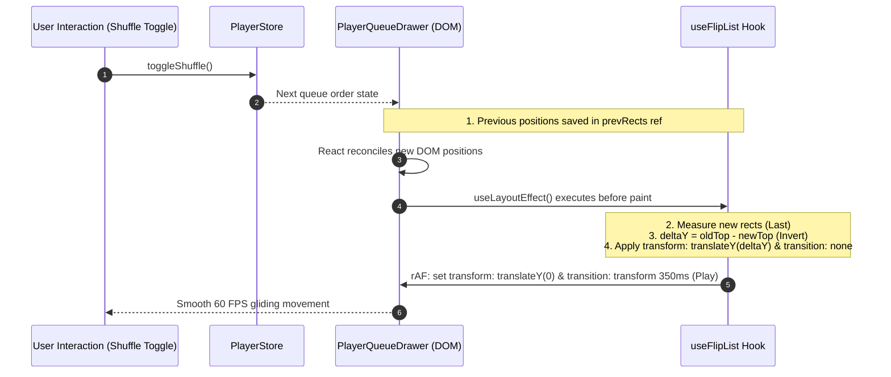

# Design: Playlist Expand & Shuffle Reorder Animation

- **Date:** 2026-11-21
- **Status:** Approved / Implemented
- **Target Components:** Frontend (`PlayerQueueDrawer.tsx`, `GlobalPlayer.tsx`, `useFlipList.ts`)

---

## 1. Overview

This design outlines the architecture and animation specifications for two key player queue interactions:
1. **Playlist Expand/Collapse Drawer Animation**: A smooth, spring-damped slide-in and expand animation when opening and closing the playback queue drawer (`PlayerQueueDrawer`), paired with an unobtrusive backdrop blur overlay and Escape key support.
2. **Shuffle FLIP (First, Last, Invert, Play) Reorder Animation**: A silky smooth layout animation where track items in the queue physically glide up and down into their new positions when shuffle is toggled (both ON and OFF), or when the queue reorders.

---

## 2. Requirements

### 2.1 Functional Requirements

- **FR-1 (Playlist Drawer Expand Animation)**:
  - Clicking the queue toggle button in the bottom player bar opens the `PlayerQueueDrawer` with a smooth horizontal expand and slide-in transition from the right.
  - Closing the drawer triggers an equally smooth slide-out and collapse transition before unmounting or being hidden from pointer events.
  - A subtle backdrop overlay fades in/out simultaneously. Clicking the backdrop or pressing the `Escape` key closes the drawer.
  - The drawer docks neatly from viewport top (`top-0`) to above the fixed bottom player bar (`bottom-20`), ensuring full playback controls remain visible and interactive.
- **FR-2 (Shuffle Reorder FLIP Animation)**:
  - When shuffle is enabled or disabled, tracks in `PlayerQueueDrawer` animate vertically (`translateY`) to their new positions.
  - Tracks moving down smoothly glide downwards; tracks moving up glide upwards; the currently playing track stays pinned at index 0.
  - The reorder animation is fluid, hardware-accelerated (`transform`), and handles rapid clicks without visual distortion or desynchronization.
- **FR-3 (In-Drawer Shuffle Control)**:
  - Add a shuffle toggle button directly to the `PlayerQueueDrawer` header so users can shuffle and observe the reorder animation without moving focus away from the list.

### 2.2 Non-Functional Requirements

- **NFR-1 (60 FPS Performance)**: All animations must use GPU-accelerated CSS properties (`transform`, `opacity`) without causing layout thrashing or repaints (`top`, `height` changes avoided during animation).
- **NFR-2 (Zero External Bloat)**: Implement the FLIP logic cleanly using modern React hooks (`useLayoutEffect`, `requestAnimationFrame`), avoiding heavy animation libraries.
- **NFR-3 (Linear Dark Theme Aesthetic)**: Adhere strictly to the established Linear dark styling: `bg-[#0f1011]/95`, `backdrop-blur-xl`, `border-white/[0.08]`, and signature cubic-bezier easing (`cubic-bezier(0.16, 1, 0.3, 1)` and `cubic-bezier(0.2, 0.8, 0.2, 1)`).

---

## 3. Architecture & Technical Design

### 3.1 Drawer Expand & Exit Transition (`PlayerQueueDrawer.tsx`)

Instead of abruptly returning `null` when `isOpen` is false, `PlayerQueueDrawer` maintains animation state:
- **Container Positioning**:
  `fixed top-0 bottom-20 right-0 w-80 sm:w-96 z-40 flex flex-col bg-[#0f1011]/95 backdrop-blur-xl border-l border-white/[0.08]`
- **CSS Transitions**:
  - Open state: `translate-x-0 opacity-100 shadow-[-12px_0_36px_rgba(0,0,0,0.5)]`
  - Closed state: `translate-x-full opacity-0 pointer-events-none`
  - Timing: `transition-all duration-300 ease-[cubic-bezier(0.16,1,0.3,1)]`
- **Backdrop Overlay**:
  `fixed inset-0 bottom-20 z-40 bg-black/40 backdrop-blur-xs transition-opacity duration-300`
  (Only active when open; closes drawer on click).

### 3.2 Shuffle FLIP Reorder Animation (`useFlipList.ts`)

The First-Last-Invert-Play technique calculates bounding rect offsets across render cycles:



#### FLIP Implementation Details:
1. **First**: Record container-relative `top` (`elementRect.top - containerRect.top` or `el.offsetTop`) for each track by its collision-free unique key (`${track.id}#${occurrence}`).
2. **Last**: In `useLayoutEffect`, measure new container-relative `offsetTop`.
3. **Invert**: If `deltaY = oldTop - newTop !== 0`, apply:
   ```ts
   el.style.transform = `translateY(${deltaY}px)`;
   el.style.transition = 'none';
   ```
4. **Play**: Using double `requestAnimationFrame` to ensure style flushes:
   ```ts
   el.style.transition = 'transform 350ms cubic-bezier(0.2, 0.8, 0.2, 1)';
   el.style.transform = 'translateY(0)';
   ```
5. **Clean up**: On `transitionend`, remove inline transition and transform styles.

---

## 4. Component Updates

### 4.1 `PlayerQueueDrawer.tsx`
- Integrate `useFlipList` hook for the queue items list container.
- Update drawer wrapping div with slide & expand transitions.
- Add backdrop overlay with click-to-dismiss.
- Add `onToggleShuffle` prop and shuffle button in header.
- Add `Escape` key listener.

### 4.2 `GlobalPlayer.tsx`
- Pass `onToggleShuffle={toggleShuffle}` to `PlayerQueueDrawer`.

---

## 5. Verification Plan

1. **Expand Animation**:
   - Verify opening the drawer slides smoothly from the right edge with spring ease.
   - Verify closing the drawer slides out smoothly without sudden snapping.
   - Verify backdrop click and Escape key close the drawer.
   - Verify the bottom player bar remains fully interactive while the drawer is open.
2. **Shuffle Reorder Animation**:
   - With 3+ songs in queue, click shuffle: observe non-current tracks glide vertically to their new spots.
   - Click shuffle again (toggle off): observe tracks glide back to their original queue positions.
   - Rapid clicking test: verify no visual glitching, jumping, or broken transforms.
3. **Build & Lint**:
   - `pnpm --prefix frontend build` completes with 0 errors.
   - `pnpm --prefix frontend lint` completes with 0 errors.
